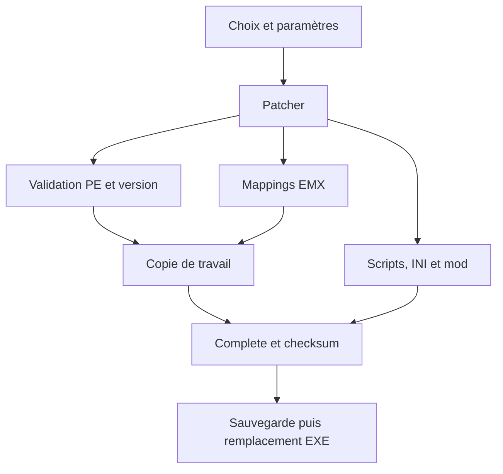

# Architecture technique de S6Patcher

Référence auditée : `matla91/S6Patcher`, branche `master`, commit
`fd44b9d367a0a43180465151aa8cd21a621d47aa` (« Prepare v9.0 »).
Les mécanismes ci-dessous décrivent aussi les protections ajoutées sur
`fix/reliability-audit-20261011` et sa suite `fix/lua-xml-reliability-20261012`,
partant du commit validé `6feaf7d535bb35a2c8b9850e2ae9d7166237229b`.
Voir [FIXES.md](FIXES.md) pour les différences.

## Compilation et dépendances

Une application C# Avalonia, sans solution `.sln`, est compilée depuis
`S6Patcher.csproj`. Elle cible .NET 10, autorise le code `unsafe` et désactive
les nullable annotations dans l'application. Les versions déclarées sont :

| Dépendance | Version | Rôle |
| --- | --- | --- |
| Avalonia, Desktop, Fluent, Inter, ColorPicker | 12.1.3 | Interface et sélecteurs |
| MessageBox.Avalonia | 12.0.0 | Dialogues |
| System.IO.Hashing | 10.0.12 | CRC32 des fichiers/archives |
| S6Packer, sous-module `Source/Archive` | `ec1424232f56a7b5c44d5c5acb4a200925573c45` | BBA, cartes, compression et chiffrement |

Les fichiers C# du sous-module sont inclus par le glob du projet principal ;
il ne s'agit pas d'un service externe ni d'une DLL téléchargée au lancement.
Il faut initialiser les sous-modules pour reproduire la compilation.
`global.json` sélectionne le SDK 10.0.100 avec possibilité de patch compatible.
Les tests utilisent l'assemblage réel de l'application, sans ouvrir une fenêtre.

Deux workflows ont des rôles distincts. `Validate.yml` exécute la matrice de
tests sur push/PR et vérifie la publication Windows, sans créer de release.
Le workflow historique `Build-Publish.yml` répond aux tags `v*` ou
à un lancement manuel et prépare des ZIP Windows/Linux puis une release **draft**.
Son SDK est aligné à 10.0.100 : installer seulement une autre feature band via
`10.0.x` ne satisferait pas le `latestPatch` de global.json. Il utilise encore
des tags d'actions non épinglés par SHA et n'impose pas un rapport de tests en
jeu ni la CI du même commit. Il n'a pas été déclenché pendant cette mission.

La configuration Release produit un exécutable autonome, en fichier unique,
avec trimming et compression. Les scripts, les deux définitions binaires et
le petit `mod.bba` embarqué sont des ressources. Aucun exécutable propriétaire
du jeu n'est nécessaire à la compilation ni aux tests.

## Répartition des responsabilités

| Fichier ou groupe | Responsabilité |
| --- | --- |
| `Source/Program.cs`, `App.axaml*` | Démarrage Avalonia et fenêtre principale |
| `Views/MainWindow.axaml*`, `ViewHelpers.cs` | Sélection, options, orchestration, dialogues, outils d'archives |
| `Views/GameCustomization.axaml*` | Paramètres existants de couleur et de limites |
| `Patcher/Patcher.cs` | Génération et application des mappings, finalisation explicite |
| `Patcher/Validator.cs` | PE32/i386, version, identification OV/HE/éditeur, signature Steam |
| `Patcher/Mappings.cs` | Codes de features et substitution de paramètres dans les mappings |
| `Utilities/BinaryParser.cs` | Décompression et parsing des définitions EMX |
| `Utilities/ExecutableTransaction.cs` | Copie de travail, sauvegarde et remplacement de l'EXE |
| `Patcher/CheckSumCalculator.cs` | Checksum PE via `imagehlp.dll`, sous Windows |
| `Patcher/Mod.cs`, `FileDataPatches.cs` | Construction du Bugfix Mod à partir de sources CRC-validées |
| `Patcher/GameplayModification.cs` | Modifications XML existantes, DTD/interpréteur externe interdits |
| `Patcher/UserScriptHandler.cs` | Profils Documents et lot des trois scripts |
| `Patcher/ArchiveGuard.cs`, `Archives.cs` | Prévalidation BBA et extraction contrôlée |
| `Utilities/AtomicFile.cs`, `SafePath.cs`, `OptionsFile.cs` | Écriture par fichier, chemins relatifs et édition INI |
| `Utilities/IOFileHandler.cs`, `Logger.cs`, `WebHandler.cs` | Ressources, journal et téléchargements avec repli |

## Identification des éditions

Les offsets sont des positions dans le **fichier**, pas des adresses virtuelles
d'un processus. Le texte UTF-16 attendu est `1, 71, 4289, 0`.

| `execID` | Édition | Offset du texte de version | Contrôle supplémentaire |
| --- | --- | --- | --- |
| 0 : OV | Original Release, version 1.71.4289 | `0x6ECADC` | `84 C0` à `0xC044` |
| 1 : HE_STEAM | History Edition Steam décompressée | `0xF545A4` | `84 C0` à `0x1E0F08` |
| 2 : HE_UBISOFT | History Edition Ubisoft | `0xF531A4` | PE32 + signature de version |
| 3 : ED | Éditeur | `0x6D06A8` | PE32 + signature de version |

Le contrôle OV conserve le comportement existant de vérification de l'EXE
décompressé. Le projet annonce Steamless pour les éditions Steam ; cet audit
n'a ni obtenu ni décompressé un EXE du jeu. Plusieurs marqueurs d'édition dans
le même fichier sont maintenant refusés.

**Limite : cette identification ne certifie pas les octets à chaque site de
patch.** Le format actuel ne contient pas leurs préimages. Une image artificielle
PE32 munie du bon texte peut encore satisfaire `Validator`. La table est un
contrôle de compatibilité hérité, pas une liste cryptographique de builds autorisés.

## Définitions et patches

`Definitions/Definitions.bin` est gzip-compressé. Après décompression :

1. Magic `EMX`, puis version de format `1`.
2. Un bloc par édition : ID sur un octet, taille `uint32`, contenu.
3. Chaque entrée : feature sur trois octets, offset `uint32`, taille `uint16`, octets.

Les entiers sont little-endian. Le fichier embarqué contient 163 entrées :
40 OV, 46 HE Steam, 46 HE Ubisoft et 31 éditeur.

| Codes | Fonction |
| --- | --- |
| HTS, SCP, ENL, BMB, DVM, AET, SBF, LME | Features sélectionnables ou imposées par l'interface selon l'édition |
| GTS | Résolutions des trois niveaux de texture |
| ATS | Opcode d'autosave et intervalle en millisecondes |
| ZLM | Limite de zoom et distance des détails |
| DCP | Redirection du dossier Documents |
| SFM | Chargement des scripts utilisateur/menu |
| EDG | Mode de debug existant |
| MDL | Ajout des chemins/archives ModLoader au chargement du jeu |

Certaines entrées d'un octet sont des **marqueurs de paramètres**, pas les
octets définitifs à écrire : `00`, `01`, `02` ou `CC`. `Mappings` les remplace
par des floats/doubles/uints ou le chemin UTF-16 avec terminaison nulle.
Ces marqueurs sont désormais reconnus par longueur et valeur exactes.

Les patches comprennent des instructions x86 et des données. Le patcher C#
n'ouvre pas le processus du jeu, n'utilise pas `WriteProcessMemory` et ne cherche
pas dynamiquement de signatures mémoire. L'injection et les changements de
chargement sont préparés dans l'EXE sur disque ; les callbacks Lua travaillent
ensuite dans les états de script du jeu.

MDL et DCP ont des plages qui se chevauchent dans les trois éditions du jeu.
L'ordre MDL puis DCP est donc significatif et conservé. La documentation des
préimages et du rôle de chaque instruction reste à produire avec des builds
de référence légalement disponibles ; modifier leur ordre sans cette étude
serait dangereux.

## Cycle d'une opération



La sélection verrouille l'EXE et crée une copie temporaire voisine. Les patches
sont écrits dans cette copie avec contrôle des bornes. Choisir un fichier,
fermer la fenêtre ou rencontrer une exception ne valide pas cette copie.
`Complete` exige l'absence d'erreurs, finalise le checksum Windows et les INI,
crée une première sauvegarde si nécessaire, puis remplace l'EXE. `Dispose`
abandonne seulement les opérations non validées.

La sauvegarde moderne est `<nom>.backup` ; le nom historique `<nom>_BACKUP.exe`
reste reconnu lors d'une restauration. La restauration contrôle l'édition et
utilise une copie de la sauvegarde, qui demeure disponible. Elle ne restaure
pas automatiquement les INI ni les scripts partagés dans Documents.

Le flag Large Address Aware est le bit `0x20` des Characteristics PE. Le checksum
est calculé dans la copie de travail ; l'interop native retourne maintenant
un pointeur `IntPtr`, conformément au contrat Windows.

## ModLoader et XML

La racine de l'installation est déduite des parents du chemin de l'EXE : deux
niveaux pour OV, trois pour HE. Ces conventions restent celles du projet initial.
Déplacer uniquement l'EXE rompt cette convention ; il faut une installation de
test complète avec la même arborescence.

| Édition | Sources | Mods de l'utilisateur | Bugfix Mod généré |
| --- | --- | --- | --- |
| OV | `<racine>/base/bba`, `extra1/bba` | `modloader/base/mod.bba`, `extra1/mod.bba` | `modloader/shr/mod.bba` |
| HE | `<racine>/Data/base/shr`, `Data/extra1/shr` | `modloader/base/shr`, `extra1/shr` | `modloader/shr` |

`FileData.bin` utilise le même en-tête EMX/gzip puis une suite de fichiers :
nom de BBA et chemin UTF-8 chacun précédé de sa longueur `uint32`, CRC32 de la
source, nombre d'opérations, et couples offset/données de longueurs `uint32`.
Les 13 fichiers embarqués reçoivent des remplacements, insertions ou suppressions.
Les opérations s'appliquent dans l'ordre décroissant des offsets.

Les CRC sont vérifiés avant modification. Les chemins absolus, `..`, ADS et
liens détectés sous la racine sont refusés. Le nouveau Bugfix Mod est généré
dans un dossier temporaire, puis installé seulement si tout réussit ; les
répertoires `base` et `extra1` de l'utilisateur ne sont pas vidés.

Les options de gameplay existantes construisent des modifications XML distinctes.
La lecture interdit les DTD et les résolveurs XML externes. Chaque opération
est liée à son archive/fichier ; la totalité du mapping, les cardinalités,
les conteneurs et les cibles scalaires sont validés avant toute mutation.
Les couleurs sont sélectionnées par enfants directs de `Color` d'une même
collection, les soldats/entrepôts par leur conteneur unique. Le namespace par
défaut est conservé ; les homonymes de namespace étranger ne sont pas ciblés.
Les cinq `SettlerLimit` et le premier `Worth` gardent leur ordre historique,
sans supposer d'IDs/racines non documentés. Une erreur produit une exception
avec contexte fichier et aucun contenu partiellement mis à jour. Les contrats
et limites de compatibilité sont dans [FIXES.md](FIXES.md). Les conflits de
définitions visant le même fichier restent refusés.

Le remplacement du dossier de mod utilise deux renommages avec retour arrière
sur erreur. Il ne fournit pas encore de journal de récupération après une panne
de courant entre ces renommages.

## Scripts, caméra et configuration

Le profil Documents contient `Config/Options.ini` et `Script/` :

| Ressource | Exécution |
| --- | --- |
| `UserScriptGlobal.lua` | État de simulation : correctifs de campagne, feu des bandits, chevaliers et effets |
| `UserScriptLocal.lua` | État GUI : boutons, sélection, cycle visuel jour/nuit, caméra et entrées |
| `EMXBinData.s6patcher` | Version minifiée/précompilée du script de menu |
| `MainMenuUserScript.lua` | Source lisible du menu, des résolutions et de ses options |

Le script du menu expose les features existantes par `Options`. Le script local
enchaîne des callbacks du jeu et, pour certains changements de simulation,
construit des commandes transmises par `GUI.SendScriptCommand`. Le cycle jour/nuit
joue une séquence d'environnement en fin de mois ; aucun nouvel effet graphique
ni changement de gameplay n'a été ajouté dans cette mission.

Les deux callbacks de feu de bandits utilisent un hook de `Logic.CreateEntity`
limité à la durée de l'appel. Chaque invocation possède son snapshot de table
et fonction ; `xpcall` permet de tenter la restauration après une faute, avant
de propager l'erreur initiale. Les diagnostics sont protégés et l'état restauré
est vérifié. Les imbrications sont indépendantes ; les hooks permanents des
autres features ne sont pas transformés. Les callbacks doivent rester synchrones en
Lua 5.1 ; les erreurs natives fatales et refus d'écriture du moteur sont des
limites explicites, pas des succès de récupération.

La première personne utilise le comportement caméra 5 et le widget ThroneRoom
pour l'actualisation, puis retourne au comportement stratégique 0. Son origine
est l'approche du marché du joueur ; elle ne dépend pas de la présence d'habitants.
Elle garde les déplacements et réglages FOV/distance **déjà présents** dans le
projet ; aucune nouvelle commande de PNJ, aucun mouvement ou réglage supplémentaire.

L'état ajouté distingue activation effective et récupération incomplète.
L'origine, les touches et les coordonnées sont vérifiées avant modification ;
les échecs d'entrée/de frame déclenchent une restauration. Les widgets modifiés
sont mémorisés et la page est retirée une seule fois. Les callbacks originaux
continuent à fonctionner hors FPS. Une cinématique détectée conserve son
comportement caméra ; l'arbitrage exact de ses widgets/pages exige encore le jeu.

Pour désactiver uniquement cette caméra, ajouter sous `[S6Patcher]` :

```ini
FirstPersonCamera=0
```

Le défaut reste activé, afin de préserver le comportement antérieur. Cette clé
n'est pas ajoutée au menu précompilé. Elle est lue au moment de Z et n'affecte
pas les autres features. Les préférences existantes de l'INI sont conservées
lors d'une réapplication ; seuls les défauts absents sont initialisés.

Le dossier Documents personnalisé est validé et utilisé **avant** l'installation
des scripts/INI. Il doit déjà contenir un profil de test initialisé. Les trois
scripts téléchargés doivent correspondre ensemble aux SHA-256 des ressources
embarquées ; sinon le lot embarqué complet est utilisé et le journal l'indique.

## Points d'extension raisonnables

- Ajouter une feature binaire impose un mapping par édition, des préimages
  documentées et des tests de génération/bornes ; ne pas étendre les offsets à
  une nouvelle version par simple ressemblance du texte de version.
- Ajouter une correction Lua impose le chaînage des callbacks, un chemin de
  désactivation et des tests de transitions ; toute API native simulée doit
  également être validée en jeu.
- Ajouter une modification XML impose des fichiers/occurrences explicitement
  compatibles, des tests sur XML synthétique et la validation des campagnes.
- Modifier le menu impose la régénération vérifiable d'`EMXBinData.s6patcher` ;
  le dépôt ne fournit pas encore cette chaîne de production.

La licence MIT de l'auteur original et celle de S6Packer sont conservées. Les
assets binaires existants ne sont pas remplacés, et aucun fichier propriétaire
du jeu ou sauvegarde réelle n'a été ajouté.
